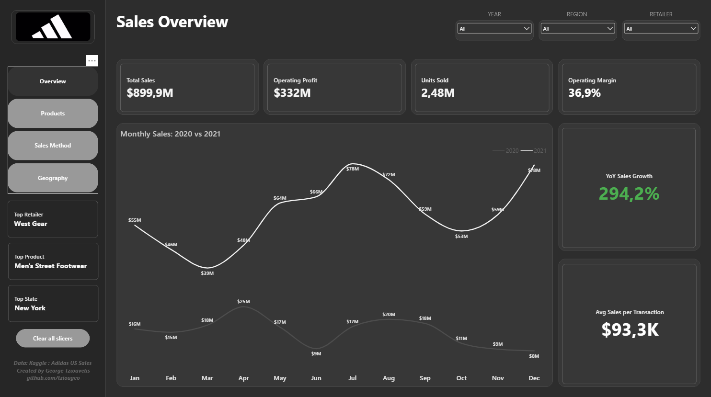
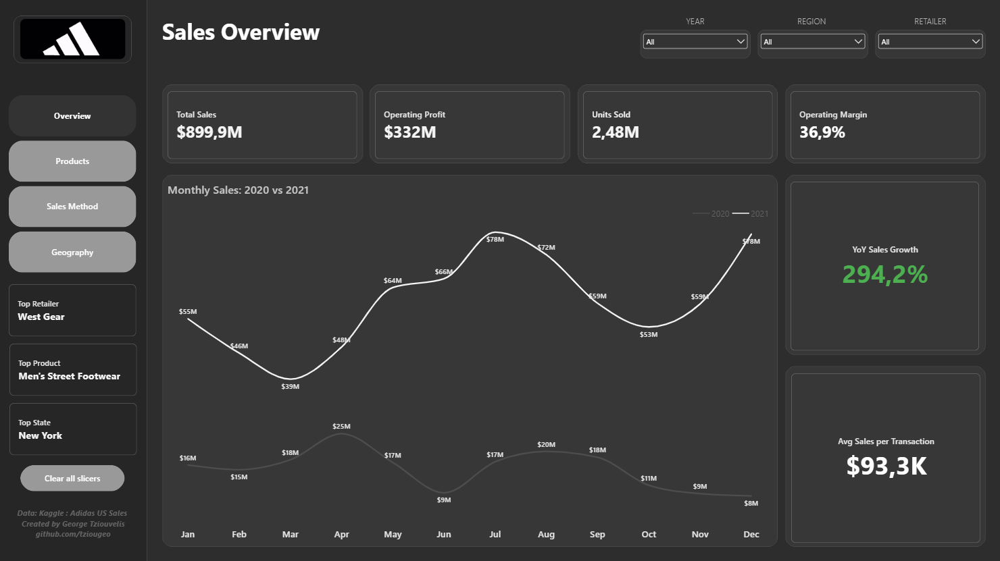
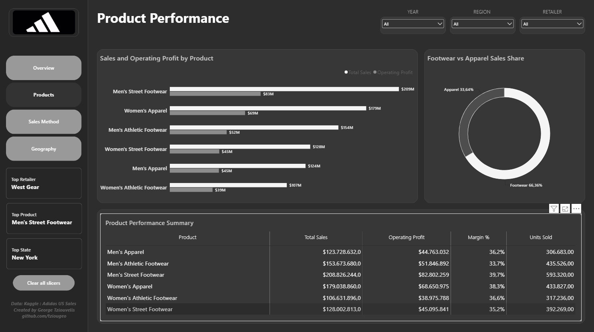
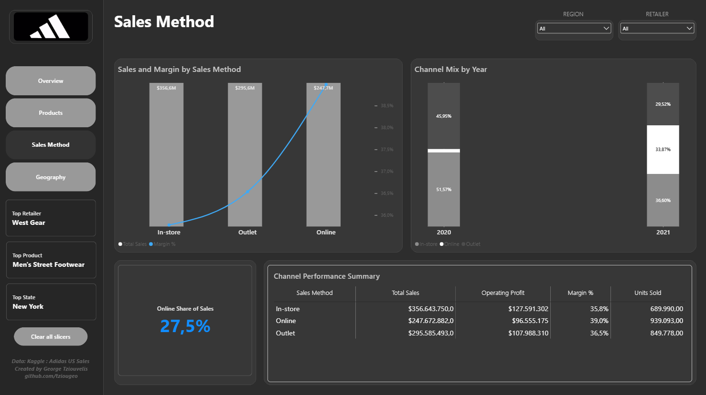
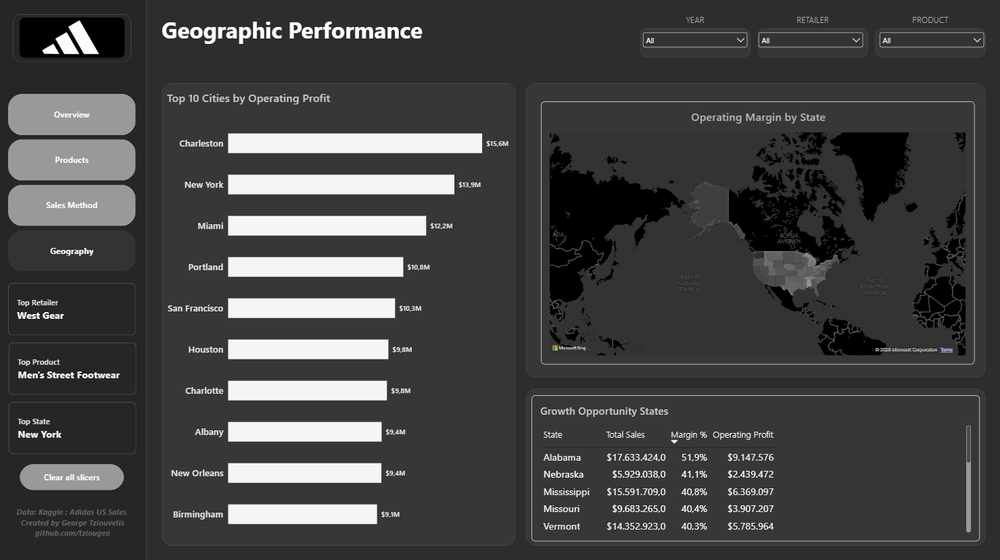

# Adidas US Sales Analysis | Power BI

An interactive Power BI dashboard analyzing Adidas sales in the United States (2020–2021) across products, sales channels, retailers, and geography.



---

## Business Questions

**Overview**
- What are total sales, operating profit, units sold, and operating margin?
- How much did sales grow from 2020 to 2021 (YoY %)?
- What is the average sales value per transaction?

**Products**
- Which product category generates the most revenue, and which the most profit?
- Footwear vs. Apparel: which drives more sales?

**Sales Method**
- Online, in-store, or outlet: which channel brings the most revenue and the highest margin?
- Did the online share of sales change from 2020 to 2021?

**Geography**
- Which are the top 10 cities by operating profit?
- Which states have a high margin but low sales (growth opportunities)?

---

## Dataset

- **Source:** [Adidas Sales Dataset – Kaggle](https://www.kaggle.com/datasets/heemalichaudhari/adidas-sales-dataset)
- **Period:** January 2020 – December 2021 (USA)
- **Columns:** Retailer, Retailer ID, Invoice Date, Region, State, City, Product, Price per Unit, Units Sold, Total Sales, Operating Profit, Operating Margin, Sales Method
- **Note:** This is a practice dataset and may not reflect Adidas' actual financial results.

---

## Tools

- **Power BI Desktop:** data modeling, DAX measures, dashboard design
- **Power Query:** data type checks (Invoice Date → Date)

---

## Data Model

- **Fact table:** `Data Sales Adidas`
- **Date table:** created with DAX (`CALENDAR`), marked as date table, linked to `Invoice Date` (1:*)
- **Calculated column:** `Product Type` (Footwear / Apparel)

### Key DAX Measures

```dax
Total Sales = SUM('Data Sales Adidas'[Total Sales])
Operating Profit = SUM('Data Sales Adidas'[Operating Profit])
Units Sold = SUM('Data Sales Adidas'[Units Sold])
Margin % = DIVIDE([Operating Profit], [Total Sales])
Avg Sales per Line = DIVIDE([Total Sales], COUNTROWS('Data Sales Adidas'))

YoY Growth % = DIVIDE([Sales 2021] - [Sales 2020], [Sales 2020])

Online Share % =
DIVIDE(
    CALCULATE([Total Sales], 'Data Sales Adidas'[Sales Method] = "Online"),
    [Total Sales]
)

Opportunity Flag =
IF(
    [Margin %] > [Overall Margin %] && [Total Sales] < [Avg State Sales],
    "Growth Opportunity",
    "Other"
)

Top Retailer =
MAXX(
    TOPN(1, VALUES('Data Sales Adidas'[Retailer]), [Total Sales]),
    'Data Sales Adidas'[Retailer]
)
```

**Weighted margin:** Operating margin is calculated as `Operating Profit / Total Sales`, not as a simple average of the `Operating Margin` column, so larger transactions carry their proper weight.

---

## Dashboard Pages

| Page | Content |
|---|---|
| **Sales Overview** | KPI cards, monthly sales trend 2020 vs 2021, YoY growth |
| **Product Performance** | Sales and profit by product, Footwear vs Apparel share, product summary table |
| **Sales Method** | Sales and margin by channel, channel mix by year, online share |
| **Geographic Performance** | Top 10 cities by profit, margin by state, growth opportunity states |

Every page includes slicers (Year, Region, Retailer, Product), dynamic **Top Retailer / Top Product / Top State** cards, and a **Clear all slicers** button.

---

## Key Insights

- **$899.9M** total sales and **$332.1M** operating profit, with a **36.9%** operating margin.
- **Men's Street Footwear** is the best-selling category ($208.8M) and has the highest margin (39.7%).
- **Footwear** accounts for about **two-thirds** of total sales.
- **In-store** brings the most revenue ($356.6M), but **Online** has the highest margin (39.0%).
- The online share grew from about **2%** of sales in 2020 to about **34%** in 2021.
- **West Gear** is the top retailer, **New York** is the top state, and **Charleston** is the most profitable city.
- **Growth opportunities:** Alabama, Nebraska, Mississippi, Missouri, and Vermont have above-average margins but below-average sales.

### Data Note
The dataset contains far fewer records for 2020 than for 2021. The **YoY growth of ~294%** therefore reflects data coverage more than real business growth, and should be interpreted with caution.

---

## Screenshots

| Overview | Products |
|---|---|
|  |  |

| Sales Method | Geography |
|---|---|
|  |  |

---

## Repository Structure

```
adidas-sales-powerbi/
├── Adidas_Sales_Dashboard.pbix
├── README.md
└── screenshots/
    ├── 01_overview.png
    ├── 02_products.png
    ├── 03_sales_method.png
    └── 04_geography.png
```

---

## Author

**George Tziouvelis**
[LinkedIn](https://www.linkedin.com/in/george-tziouvelis) · [GitHub](https://github.com/tziougeo)
